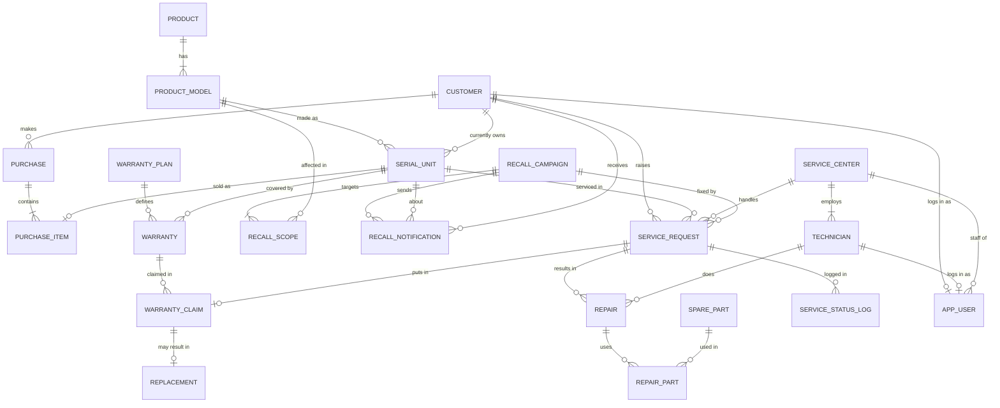

# 2. ER Diagram and Relational Schema

## ER diagram

Insert the redrawn hand-drawn ER diagram here as `screenshots/er_diagram.png`. The diagram below is generated from the final schema and renders on GitHub.

## Relational schema

Primary keys are marked PK and foreign keys FK.

### Sales module

- customer (customer_id PK, full_name, email UNIQUE, phone UNIQUE, address, city, preferred_channel, registered_on)
- product (product_id PK, product_name, brand, category), UNIQUE (brand, product_name)
- product_model (model_id PK, product_id FK, model_code UNIQUE, model_name, launch_date, mrp)
- serial_unit (serial_id PK, serial_no UNIQUE, model_id FK, manufacture_date, status, current_owner_id FK customer)
- purchase (purchase_id PK, invoice_no UNIQUE, customer_id FK, purchase_date, channel, total_amount)
- purchase_item (purchase_item_id PK, purchase_id FK, serial_id FK UNIQUE, unit_price)
- warranty_plan (plan_id PK, plan_code UNIQUE, plan_name, plan_type, duration_months, max_claims, coverage_desc, price)
- warranty (warranty_id PK, serial_id FK, plan_id FK, start_date, end_date, status)
- recall_campaign (recall_id PK, recall_code UNIQUE, title, reason, severity, remedy, announced_on, status)
- recall_scope (scope_id PK, recall_id FK, model_id FK, mfg_from, mfg_to), UNIQUE (recall_id, model_id, mfg_from)
- recall_notification (notification_id PK, recall_id FK, serial_id FK, customer_id FK, channel, notified_at, status), UNIQUE (recall_id, serial_id)

### Service module

- service_center (center_id PK, center_code UNIQUE, center_name, city, address, phone, email UNIQUE)
- technician (technician_id PK, center_id FK, full_name, phone UNIQUE, email UNIQUE, skill_level, specialization, is_active)
- spare_part (part_id PK, part_code UNIQUE, part_name, part_category, unit_price, stock_qty, reorder_level)
- service_request (request_id PK, customer_id FK, serial_id FK, center_id FK, request_date, issue_type, recall_id FK, issue_description, priority, status, closed_at)
- repair (repair_id PK, request_id FK, technician_id FK, assigned_at, completed_at, labour_charge, status, resolution_notes)
- repair_part ((repair_id, part_id) PK, repair_id FK, part_id FK, quantity, unit_price)
- warranty_claim (claim_id PK, warranty_id FK, request_id FK UNIQUE, claim_date, claim_type, status, approved_amount, remarks)
- replacement (replacement_id PK, claim_id FK UNIQUE, old_serial_id FK, new_serial_id FK UNIQUE, replaced_on, notes)
- service_status_log (log_id PK, request_id FK, old_status, new_status, changed_at, changed_by)
- app_user (user_id PK, username UNIQUE, email UNIQUE, password_hash, role, customer_id FK UNIQUE, technician_id FK UNIQUE, center_id FK, is_active, created_at)

### Vector store (PostgreSQL)

- issue_embedding (request_id PK, product_category, model_name, issue_type, issue_text, resolution_text, embedding VECTOR(384), embedded_at)

request_id is a logical link to service_request in MySQL. A foreign key cannot cross two database servers, so the application keeps them in step (see section 7).

## Normalisation

All tables are in third normal form. Every non-key attribute depends only on the key: product details live in product and product_model, not in serial_unit; plan duration lives in warranty_plan, not in warranty. Two values are stored deliberately for speed and history: purchase.total_amount (kept correct by triggers) and repair_part.unit_price (the price at the time the part was used, which must not change when the catalogue price changes).

## Changes from the original hand-drawn diagram

1. WARRANTY_TYPE became warranty_plan with type, duration, claim limit and price, so one unit can hold a standard and an accidental damage plan together.
2. RECALL_PRODUCT became recall_scope, defined by model and manufacture date range instead of serial number ranges.
3. PURCHASE_ITEM lost quantity, since each row is one serial-numbered unit.
4. serial_unit gained current_owner_id so ownership carries over after a replacement.
5. app_user and service_status_log were added for login and auditing.
6. A warranty claim is unique per service request, and replacement stores both the old and the new unit.
