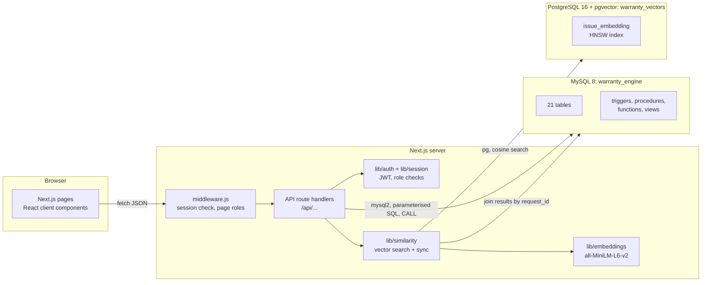

# 9. System Architecture

## Layers

| Layer | Technology | Responsibility |
|---|---|---|
| Presentation | Next.js 14 App Router, React 18 | Pages per role: forms, tables, dashboards, search |
| Access control | middleware.js, jose (JWT) | Every request needs a valid session cookie; pages are limited by role |
| API | Next.js route handlers | Input checks, role checks, row-level checks (own center, own jobs, own units), calls into the databases |
| Relational data | MySQL 8, mysql2 | All business data and rules (constraints, triggers, procedures, transactions) |
| Semantic search | PostgreSQL 16 + pgvector, pg | Embeddings and nearest neighbour search |
| Embedding | @xenova/transformers | Turns text into 384-number vectors locally |

## Authentication and authorisation

1. `POST /api/auth/login` loads the user from app_user and checks the password with bcrypt.
2. On success the server signs a JWT (HS256, 8 hours) containing the user id, role and linked customer, technician or center id, and stores it in an httpOnly cookie, so page scripts cannot read it.
3. `middleware.js` verifies the token on every request. Without it, pages redirect to /login and APIs return 401. Pages outside the user's role redirect home.
4. Each API route calls `requireRole([...])` and returns 403 for other roles. Routes also apply row-level rules: staff see only their center, technicians only their jobs, customers only their own units and requests.

| Role | Can do |
|---|---|
| ADMIN | everything, including recall notifications and restocking parts |
| SERVICE_STAFF | customers, sales, warranty lookup, recalls, their center's queue and claims |
| TECHNICIAN | own jobs, parts, warranty lookup, similar issue search |
| CUSTOMER | own products, warranties, recall notices and service requests |

## Configuration

Credentials live in `web/.env.local` (not committed). `web/.env.example` lists the variables: MYSQL_*, PG_* and JWT_SECRET. `lib/mysql.js` and `lib/postgres.js` read them through `process.env`.

## Request flow example: completing a repair

1. The technician clicks Complete; the page sends `POST /api/repairs/17 {action: complete}`.
2. Middleware verifies the session; the route checks the role and that the repair belongs to this technician.
3. The route calls `sp_complete_repair` (transaction). Trigger `trg_repair_au` marks the request COMPLETED and settles an approved claim with `fn_repair_cost`; `trg_sr_au` writes the audit log.
4. The route re-embeds the request so its fix becomes searchable in PostgreSQL.
